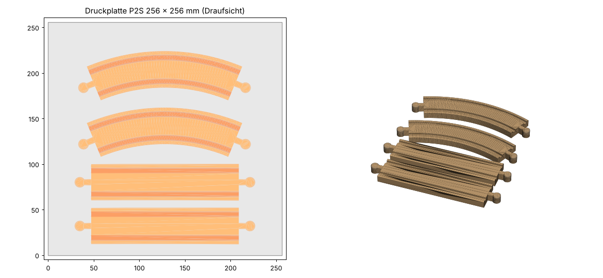

# Lillabo-Schienen mit zwei Zapfen (Stecker/Stecker)

Gerade Schiene und 45°-Kurve für die IKEA-LILLABO-Holzeisenbahn, jeweils mit einem **männlichen Anschluss an beiden Enden**.
Damit braucht man die kleinen grauen Kunststoff-Verbinder („Knochen“) nicht mehr, die verschluckt werden können.
Benötigt werden je 2 Stück, also 4 Teile auf einer Druckplatte.

## Dateien

| Datei | Zweck |
|---|---|
| `Lillabo_Stecker_Stecker.FCStd` | FreeCAD-Modell mit beiden Schienen und Tabellenblatt **Parameter** |
| `lillabo_male_male.FCMacro` | FreeCAD-Makro, baut die Schienen aus den Parametern neu auf |
| `export/Gerade_MM.step`, `export/Kurve_MM.step` | Einzelteile für Bambu Studio (STEP bevorzugt importieren) |
| `export/Gerade_MM.stl`, `export/Kurve_MM.stl` | Einzelteile als feines STL |
| `Lillabo_Stecker_Stecker_Platte.3mf` | 2× gerade + 2× Kurve bereits auf der 256 × 256 mm Platte angeordnet |
| `build.py` | baut alles ohne Oberfläche neu: `freecadcmd build.py` |

### Maße ändern

1. `Lillabo_Stecker_Stecker.FCStd` in FreeCAD öffnen.
2. Im Tabellenblatt **Parameter** den Wert ändern, z. B. `LaengeGerade`.
3. **Makro → Makros…** → `lillabo_male_male.FCMacro` → **Ausführen**. Die Körper werden neu aufgebaut.
4. Körper markieren → **Datei → Exportieren** als STEP.

Das Modell wurde mit FreeCAD 26.3 erzeugt. Falls eine ältere Version die `.FCStd` nicht öffnet: neues leeres Dokument anlegen und das Makro ausführen, es legt Tabellenblatt und Körper selbst an.

## Maße und Herkunft

Offizielle Einzelmaße veröffentlicht IKEA nicht. Die Werte stammen aus dem BRIO-Standard (LILLABO ist dazu kompatibel) und wurden an den Fotos der eigenen Schienen nachgemessen. Als Maßstab diente die Schienenbreite von 40 mm.

| Maß | Modell | Quelle |
|---|---|---|
| Breite × Höhe | 40 × 12 mm | BRIO-Standard (woodenrailway.info) |
| Rillen | 6 mm breit, 3 mm tief, Mittenabstand 26 mm | BRIO-Standard, im Foto bestätigt (Rillenmitte ±13 mm) |
| Länge gerade (ohne Zapfen) | **162 mm** | Foto gemessen: 161–163 mm |
| Kurve | 45° (8 Stück = Kreis), Radius Mitte **202,5 mm**, innen 182,5 / außen 222,5 mm | BRIO-„E“-Kurve (Mitte ≈ 202 mm), passt zu Fremdkurven „8 Stück = Innendurchmesser 36,5 cm“ und zur Foto-Proportion |
| Zapfenkopf | Ø 11,5 mm | BRIO 11,5 mm, Foto 11,4 mm |
| Zapfenhals | 6,5 mm breit | Foto 6,3 mm, für mehr Festigkeit leicht verbreitert. Die Lochöffnung der Lillabo-Schiene ist ca. 7,6 mm breit |
| Zapfenlänge gesamt | 18,0 mm ab Stirnfläche | Foto 18,4 mm, Lochtiefe ca. 19 mm |
| Loch der Lillabo-Schiene (zum Vergleich) | Ø ca. 13,5 mm | Foto. Gut 2 mm Spiel zum Zapfen, so wie bei BRIO üblich |

Kanten: oben 1 mm Fase, unten 0,5 mm Fase (gegen Elefantenfuß), Rillenkanten 0,5 mm Fase, Rillengrund mit 1 mm Rundung, Zapfenoberkante 0,8 mm Fase.

**Bitte einmal nachmessen:** gerade Lillabo-Schiene mit dem Zollstock ohne Zapfen. Liegt sie nicht bei 162 mm, `LaengeGerade` anpassen. Durch das Spiel in den Verbindungen sind ±2 mm unkritisch.

---

## Druckparameter Bambu Lab P2S (Bambu Studio)

### Kurzfazit

**PETG** (Preset *Bambu PETG HF*) auf der **Textured PEI Plate**, Basisprofil **0.20mm Standard @BBL P2S**, Teile **flach auf der Unterseite** (Rillen oben), **ohne Stützen**.
PETG ist zäher als PLA und bricht weniger spröde. Gerade bei Kinderspielzeug ist das wichtig, denn ein abgebrochener Zapfen wäre wieder ein Kleinteil. PLA (*Bambu PLA Basic*) geht auch, mit denselben Einstellungen.

### Ausrichtung

- `Lillabo_Stecker_Stecker_Platte.3mf` öffnen. Die 4 Teile liegen schon richtig. Alternativ die STEP-Dateien importieren, Kurve und Gerade je 1× kopieren (Strg+C / Strg+V) und mit **Anordnen (Arrange, Taste A)** verteilen.
- Unterseite auf die Platte, notfalls **Auf Fläche legen (Lay on face, Taste F)** und die flache Unterseite anklicken.
- Warum: keine Überhänge, keine Stützen. Die Zapfen werden beim Spielen seitlich gebogen und gezogen, diese Kraft wirkt dann **entlang** der Schichten statt quer dazu, also in der stabilsten Richtung.

### Abweichungen vom Profil 0.20mm Standard @BBL P2S

Tipp: Jeder Parameter lässt sich über die **Lupe (Suche)** oben im Parameterbereich finden. Manche Werte sieht man erst mit dem Schalter **Erweitert (Advanced)** oben rechts im Prozessbereich.

| Parameter | Wert | Wo in Bambu Studio | Warum |
|---|---|---|---|
| Wandschleifen (Wall loops) | **6** | Festigkeit (Strength) → Wände | Der 6,5 mm breite Zapfenhals wird dadurch praktisch massiv |
| Deckschichten (Top shell layers) | 5 | Festigkeit → Deck-/Bodenschichten | stabile Fahrfläche, keine durchscheinende Füllung |
| Bodenschichten (Bottom shell layers) | 4 | Festigkeit → Deck-/Bodenschichten | feste Unterseite |
| Fülldichte (Sparse infill density) | 20 % | Festigkeit → Füllung | Schienenkörper stabil und nicht zu schwer |
| Füllmuster (Sparse infill pattern) | Gyroid | Festigkeit → Füllung | gleichmäßig fest in alle Richtungen |
| Elefantenfuß-Kompensation (Elephant foot compensation) | 0,15 mm (prüfen) | Qualität (Quality) → Präzision | Zapfen bleibt unten maßhaltig und passt ins Loch |
| Stützen aktivieren (Enable support) | **aus** | Stützen (Support) | nicht nötig |

Das Filament-Preset *Bambu PETG HF* bleibt unverändert: Temperaturen und Kühlung passen. Bei der **Textured PEI Plate** keinen Kleber verwenden. Bei glatter PEI-Platte (Smooth PEI) unbedingt Klebestift als Trennmittel auftragen, sonst reißt PETG die Beschichtung heraus.

Optional für eine glattere Fahrfläche: Qualität → **Bügeln (Ironing)**, Bügeltyp *Oberste Fläche (Top surfaces)*. Das kostet aber deutlich mehr Zeit.

### Passungsprobe (empfohlen, ca. 10 min)

Vor dem ersten großen Druck: gerade Schiene markieren → **Schneiden (Cut, Taste C)** → ca. 25 mm hinter einem Zapfen schneiden, nur das kurze Endstück drucken.
Damit den Zapfen in eine Lillabo-Schiene und in eine Brücke oder ein anderes Teil mit zwei Löchern stecken.
- **Zu stramm:** `ZapfenKopfD` auf 11,2 und `ZapfenHalsB` auf 6,2 setzen, Makro neu ausführen.
- **Zu locker:** Werte um 0,2–0,3 mm erhöhen.

### Checkliste in der Vorschau (nach „Platte slicen / Slice plate“)

- [ ] Keine Stützen sichtbar
- [ ] Linientyp-Ansicht: Zapfenhals besteht nur aus Wänden (Wall), kaum Füllung
- [ ] Erste Schicht deckt alle 4 Teile vollständig ab
- [ ] Zeit und Filamentmenge plausibel (grob 40–60 g pro Teil)

### Speichern

**Datei → Projekt speichern (Save project)** als `Lillabo_Stecker_Stecker_PETG_0.20.3mf`. Diese Datei an den Schwager schicken, er prüft Filament und Platte und druckt.

## Sicherheit

- Nach dem Druck jeden Zapfen kräftig hin- und herbiegen und daran ziehen. Teile mit Rissen oder Weißbruch nicht verwenden.
- Kanten und Fadenreste („Stringing“ bei PETG) mit einem Cuttermesser oder Schleifpapier entgraben.
- Die Teile hin und wieder auf Risse prüfen. 3D-Drucke sind keine geprüften Spielzeuge, und die Rillen zwischen den Schichten lassen sich schlecht reinigen. Sie sind also nicht als Beißspielzeug gedacht. Als Ganzes sind sie aber viel zu groß zum Verschlucken.
